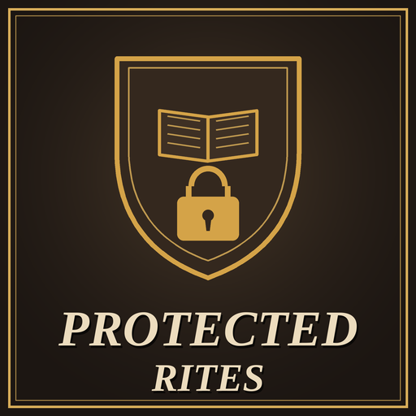

# Protected Rites

A Crusader Kings III mod that stops an AI Head of Rite from rewriting a rite you founded. Since update 1.20, the Head of Rite can edit the rite's tenets and doctrines once per lifetime. If you found a rite and its Head of Rite is an AI (for example, the clerical vassal of a secular ruler), the AI can reshape it until it has nothing in common with what you created, and push it towards heresy without you ever choosing it. With this mod, the rites you follow keep the tenets and doctrines you gave them, while the game's own rites work as in vanilla.

- **Game version:** 1.20.x
- **Mod version:** 1.0.0
- **Author:** [Sourenics](https://github.com/Sourenics)
- **Steam Workshop:** [Protected Rites](https://steamcommunity.com/sharedfiles/filedetails/?id=3826064639)

## Features

- **An AI Head of Rite cannot edit a protected rite.** Its tenets and doctrines stay as they were.
- **Which rites are protected:** a rite is protected while a player follows it, as long as it is not one of the game's own rites (Roman, Byzantine, Ambrosian, Carolingian, the heresies and so on). Rites founded during the game have no rite type, so any of them counts, including rites in an existing save. Rites founded by a player, or by a player's theological puppet, are also marked when they are founded.
- **Players edit as usual.** If you are the Head of Rite, the vanilla rules apply: once per lifetime, piety cost and so on. Compatible with [Free Rite Editing](https://github.com/Sourenics/CK3-Free-Rite-Editing).
- **Game rule PRR: Protect Mainline Rites**, in the game rules screen when starting a new game:

  | Setting | When a protected rite becomes the mainline rite |
  |---|---|
  | Protected (default) | it stays protected: an AI Head of Faith cannot edit it either |
  | Not Protected (vanilla) | its Head of Faith can edit it as in the base game, until it stops being the mainline rite |

- **Everything else stays vanilla.** Divergence, Ecumenical Councils, papal bulls, the tenet a newly elected AI Pope changes in his own rite, and changes to the mainline rite can still affect your rite or its divergence, as in the base game. Only the Head of Rite's edit is blocked.
- **A warning if something slips through.** If a protected rite changes its tenets or doctrines without a player edit while its Head of Rite is AI, you get a message, so a change the mod could not stop never goes unnoticed.

### Languages

The game rule and the message are in English and Spanish; players using any other game language see them in English. Translations are welcome: open an [issue](../../issues/new/choose) or post them on the Steam Workshop page.

## Installation

### Steam Workshop

Subscribe on the Steam Workshop page and enable the mod in the Paradox launcher.

### Manual

1. Download this repository (green **Code** button → **Download ZIP**).
2. Copy the contents of the `mod/` folder (`protected_rites/` and `protected_rites.mod`) into:
   - **Windows:** `Documents/Paradox Interactive/Crusader Kings III/mod/`
   - **Linux:** `~/.local/share/Paradox Interactive/Crusader Kings III/mod/`
   - **macOS:** `~/Documents/Paradox Interactive/Crusader Kings III/mod/`
3. Enable **Protected Rites** in the Paradox launcher.

## Compatibility

- No DLC required.
- Redefines one vanilla scripted rule, `can_edit_rite`, in its own file (`common/scripted_rules/zzz_prr_rules.txt`); the rule keeps the vanilla check and adds the protection. Other mods that redefine `can_edit_rite` are not compatible without a patch. It also adds to the `on_rite_created` and `on_rite_updated` on_actions without overriding them.
- Can be added to an existing save: rites founded during the game are recognised from the moment you enable it. Game rules cannot be changed after a game has started, so an existing save uses the default setting (Protected). Can be removed at any time.

## Reporting bugs

Please open an [issue](../../issues/new/choose) using the **Bug report** template. To be able to fix the problem we need:

1. **The `error.log` file** from the session where the problem happened:
   - **Windows:** `Documents/Paradox Interactive/Crusader Kings III/logs/error.log`
   - **Linux:** `~/.local/share/Paradox Interactive/Crusader Kings III/logs/error.log`
   - **macOS:** `~/Documents/Paradox Interactive/Crusader Kings III/logs/error.log`

   The log is overwritten every time the game starts, so copy it right after the problem happens, before launching the game again. Ideally, reproduce the problem in a session with **only Protected Rites enabled**.
2. **The game version** (shown in the main menu, for example 1.20.1) and **the mod version**.
3. **Your active DLCs** and **your full mod list in load order**.
4. **The rite** that changed or could not be edited, who founded it, who its Head of Rite is, whether it is the mainline rite, and **the game rule setting**.
5. **Screenshots** of the rite and of any message you got, if possible.

## Credits

Idea and testing by Sourenics.

## License

**Protected Rites** © 2026 Sourenics, licensed under [Creative Commons Attribution-ShareAlike 4.0 International (CC BY-SA 4.0)](https://creativecommons.org/licenses/by-sa/4.0/).

Forks, translations and alternative versions are welcome, provided that you:

- **Credit the original author** (Sourenics) and link to this repository.
- **Indicate the changes** you made.
- **Release your version under the same license** (CC BY-SA 4.0).

### Paradox Interactive content

Crusader Kings III and its content are © Paradox Interactive AB and are **not** covered by this license. This includes the `can_edit_rite` scripted rule, which is a copy of a Paradox rule with a small change by this mod. This project is an unofficial fan-made mod, not affiliated with or endorsed by Paradox Interactive. Like every CK3 mod, it must be distributed free of charge.
